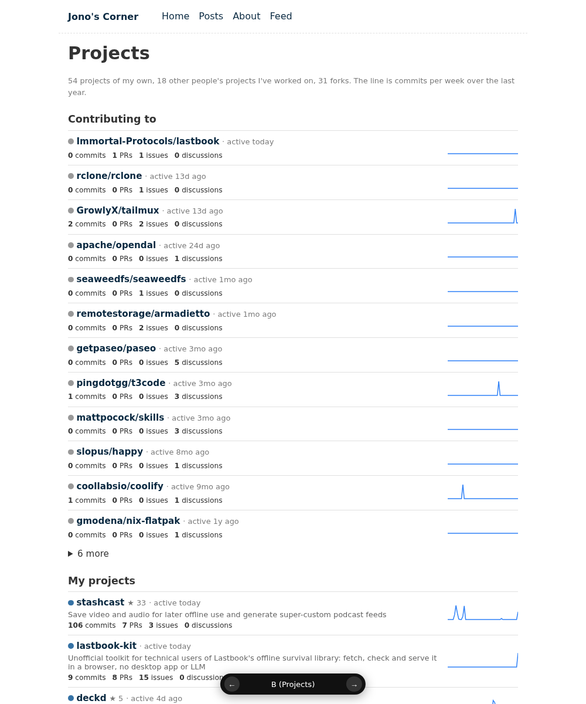

# activity

One static page with all your GitHub activity: commits (including other people's repos), repos you created and forked, issues, pull requests, discussions, pinned projects, orgs, and a per-project breakdown. Private work can be included at the level of detail you choose.

GitHub spreads this across the profile graph, the repositories tab, search and per-repo views, each with its own time window. Discussions only show up in search, and the activity feed forgets after 30 days. This puts it all on one page that you host yourself.

**Status: designed, not built yet.** See [docs/design.md](docs/design.md).

## How it will work

- A GitHub Actions workflow in your fork runs hourly. It fetches your activity from the GitHub API, optionally merges it into a SQLite file kept in a private Cloudflare R2 bucket, renders one static HTML page, and deploys it to GitHub Pages.
- Visitors get a plain static page. Nothing in the browser calls GitHub.
- Everything personal lives in `config.toml` (public: which sections to show, pinned projects) and in Actions secrets (your token, and the visibility rules for hiding or anonymising repos and orgs). You never edit code, so "Sync fork" keeps working.

## Planned setup for a fork

1. Fork this repo and enable Actions in your fork's Actions tab.
2. Create a token (see [Token](docs/design.md#token)) and add it as the `GH_PAT` secret.
3. Optional:
   - copy `config.example.toml` to `config.toml`;
   - put your visibility rules (see `rules.example.toml`) in the `ACTIVITY_RULES` secret.
4. Optional, so history GitHub forgets is kept and runs are faster: create an R2 bucket and add the Cloudflare secrets.
5. Enable GitHub Pages with "GitHub Actions" as the source.

## Docs

- [docs/design.md](docs/design.md): decisions, architecture, data sources, schema, rules, testing, build plan.
- [docs/research.md](docs/research.md):
  - what GitHub shows natively;
  - API limits, with live measurements;
  - existing tools (github-readme-stats, lowlighter/metrics, archive-style projects) and why they fall short.
- The prototype of the three views is on the [`prototype/views`](https://github.com/jonocodes/activity/tree/prototype/views) branch.
